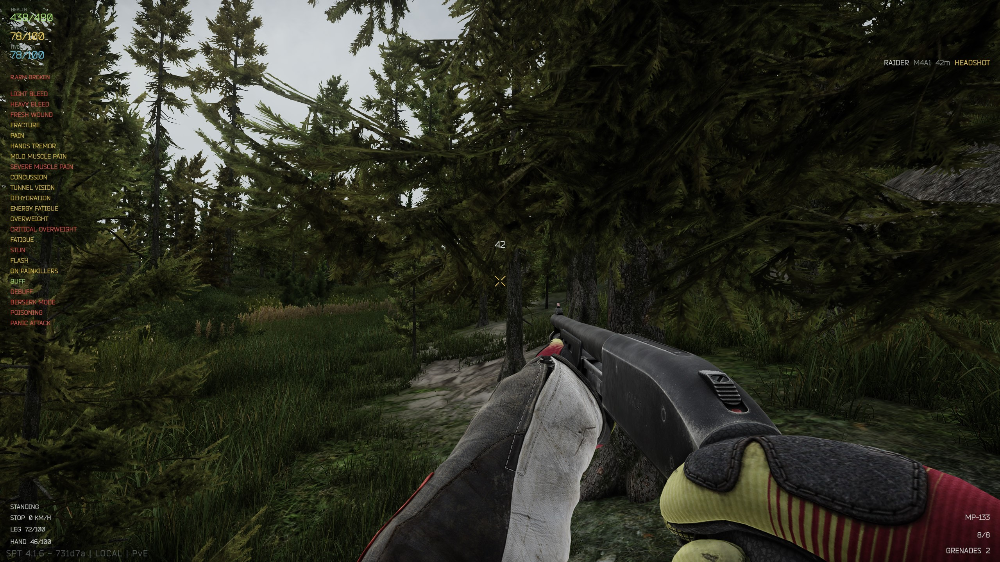
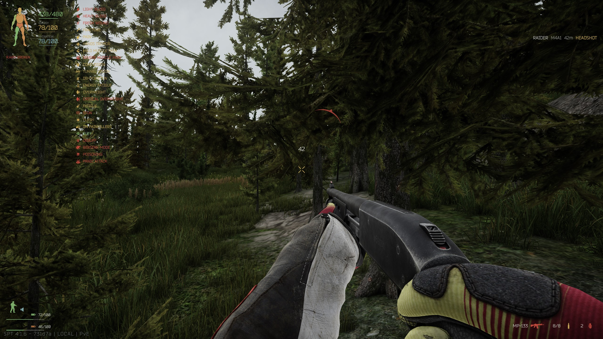
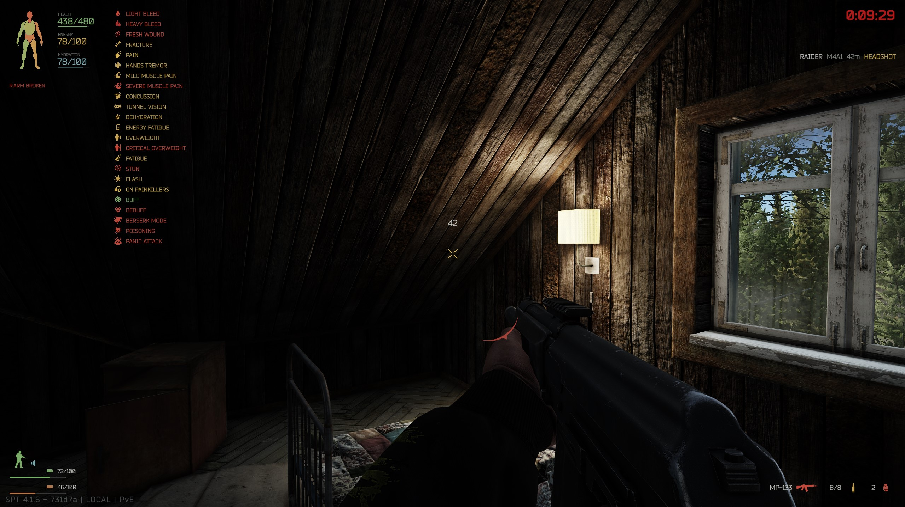
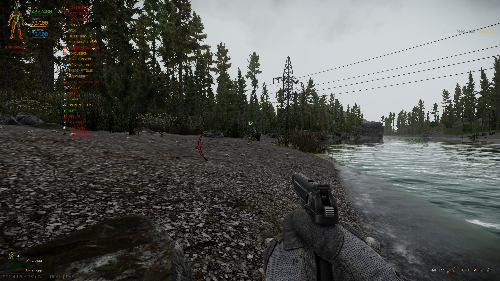
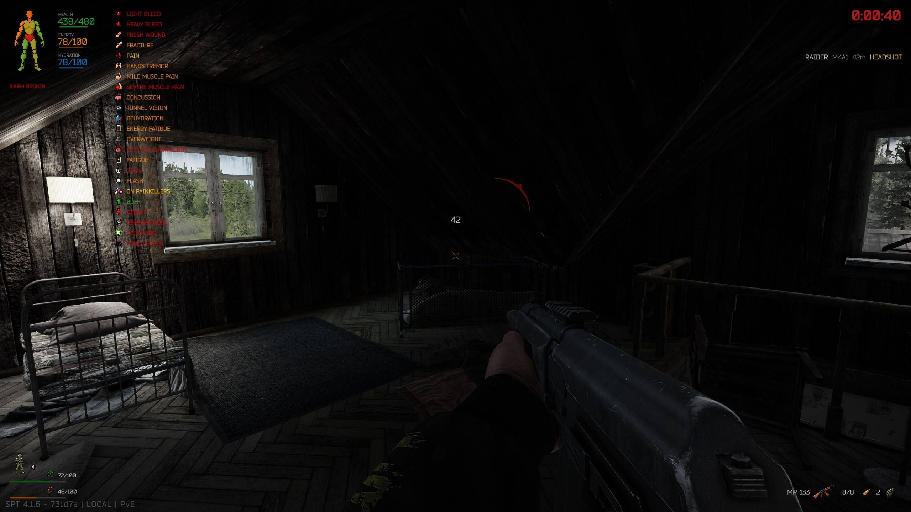
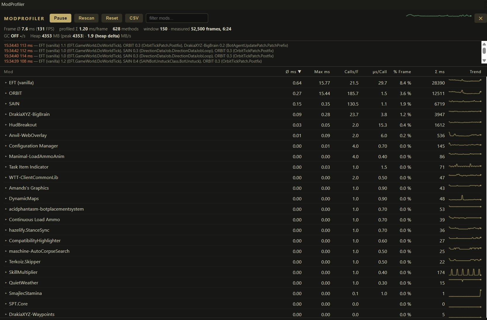

# HudBreakout

HudBreakout is a clean, lightweight HUD for SPT 4.1.5. Out of the box, the `Minimal` theme gives you a 7-part health silhouette, compact vitals, active effect icons, weapon and ammo details, movement stats, a crisp hit marker, and an unboxed kill feed.

## Customize a Theme

Themes live in `BepInEx/plugins/HudBreakout/Themes/<ThemeName>/`. To make your own, copy the `Minimal` folder, tweak `theme.xml`, and select your new folder name in the BepInEx config.

If you prefer text over icons, we've included a `TextOnly` theme that disables the silhouette and panel icons while keeping the PNG hit marker.

Press **F9** in-raid to hot-reload your XML and PNG artwork instantly without restarting the game.

I plan to create detailed documentation in github for each configuration parameter, explaining its purpose and how it affects the HUD. This will help users understand the settings and create their own custom themes.

## Screenshots

##### TextOnly

##### Minimalistic

##### Colorful Icons

### Profiler Verdict: 
Measured with Mod Profiler:
HudBreakout maintains an average overhead of just 0.03 ms per frame, accounting for only 0.4% of profiled frame time. With a recorded maximum of 0.05 ms and a stable performance trend, it demonstrates minimal CPU overhead in the tested session.

## Building and Installing

Running `dotnet build -c Release` creates `dist/HudBreakout-1.0.0.zip`. This contains the plugin DLL and themes inside the `BepInEx/plugins/HudBreakout` folder, ready to extract straight into your SPT directory. If you have your SPT directory configured in the project, it auto-deploys the plugin there during the build.

Theme coordinates use a 1920x1080 canvas. Positive X moves right, and positive Y moves up from your selected anchor. Colors take standard hex codes (`#RRGGBB` or `#RRGGBBAA`). Everything in the XML is optional—if you leave an attribute out, the HUD just falls back to the default.

### Silhouette Artwork

Drop your custom PNGs into your theme folder (e.g., `Themes/Minimal/`) right next to `theme.xml`. The XML uses a `prefix` attribute to find the files. For example, `prefix="body_minimal"` loads `body_minimal_silhouette.png` alongside seven body part variants (like `body_minimal_Head.png`). Filenames are case-sensitive. Keep all your part images aligned on the exact same canvas size so they overlap the base silhouette correctly.

The Minimal theme uses `maskMode="luminance"` to pull the dark shaded regions of the provided art into a transparent health mask, tinting it based on your current health. Tweak `maskThreshold` and `maskSoftness` for edge smoothing. If you're using standard white shapes on a transparent background, switch to `maskMode="alpha"`. `painkillerImage` selects the base image shown while a painkiller is active; it defaults to `<prefix>_outline.png`.

Want to hide the outline? Set `outline="none"`. Disable the silhouette entirely via XML (`show="false"`) or by toggling **Show Silhouette** in the F12 menu.

### Effects, Equipment, and Movement

The HUD tracks your status organically:

- **Effects:** Light/heavy bleeding, fresh wounds, fractures, pain, tremor, muscle pain, concussion, tunnel vision, dehydration, fatigue, overweight, stun, flash, painkillers, buffs, debuffs, berserk, poisoning, and panic attacks are displayed while active.
- **Equipment:** Bottom-right handles your equipped weapon, mag check, and grenades (including throwables in your rig and pockets). Ammo icons dynamically match your weapon class (e.g., assault rifles get medium ammo, SMGs get small, snipers get large).
- **Movement:** Bottom-left tracks stance, speed, and both body/hand stamina. Speed rounds to stable even numbers (2 to 14 KM/H) to prevent UI flickering.

You can toggle these sections via the F12 menu. Stamina labels stay hidden, showing only the current/max numbers next to the slim bars. You can even move the stamina bars independently of their text using the F12 X/Y sliders.

Stamina and vitals bars use PNG background and fill sprites. Set `staminaBarBackgroundSprite` and `staminaBarFillSprite` on `<Movement>`; both stamina bars share `staminaBarWidth` and `staminaBarHeight`, while their fill colors come from `IconColors` (`stamina` and `handsStamina`). For each `<Stat>`, use `barBackgroundSprite` and `barFillSprite` with `barWidth` and `barHeight`; `color` controls that stat's fill. The shipped themes use `bar_background.png` and `bar_fill.png` from `Themes/Minimal/` as fallbacks. Put custom sprite files in your theme folder beside `theme.xml`.

### Icons and Fallbacks

All icons are transparent PNGs sitting in `Themes/Minimal/Icons/`. If your custom theme is missing an icon, HudBreakout falls back to the Minimal theme's PNG, and then to a generic `default.png`.

| UI Panel      | XML Attributes & Default Files                                                                                                                                                                     |
| ------------- | -------------------------------------------------------------------------------------------------------------------------------------------------------------------------------------------------- |
| **Effects**   | Each effect accepts an optional `*Icon` attribute (for example `lightBleedIcon`, `freshWoundIcon`, `painIcon`, `buffIcon`). Missing files fall back to Minimal's matching PNG, then `default.png`. |
| **Equipment** | `weaponIcon` (weapon.png), `ammoIcon` (ammo.png), `grenadeIcon` (grenade.png). Defaults automatically scale ammo size and weapon type based on what you have equipped.                             |
| **Movement**  | `stanceIcon` (stance_stand.png), `sprintIcon` (stance_sprint.png), `speedIcon0`-`5` (six volume-level PNGs for speed tiers), `staminaIcon` / `handsStaminaIcon` (stamina.png)                      |
| **Combat**    | `HitMarker`: `image` (hit_marker_x.png), `crossImage` (hit_marker_cross.png). `DamageDirection`: `image` (damage_direction.png)                                                                    |

To hide panel icons but keep their text, set `<Icons enabled="false"/>` in your XML.

The leg icon uses `staminaIconX`, `staminaIconY`, and `staminaIconSize`; the hand icon uses `handsStaminaIcon`, `handsStaminaIconX`, `handsStaminaIconY`, and `handsStaminaIconSize`. Both icon positions also follow their corresponding stamina layout offsets.

### Preview Mode

Press the **Preview HUD Key** (default F10) while in a raid to temporarily display dummy data across all HUD elements for 5 seconds. This is perfect for testing your layout. It won't trigger in the Hideout or main menus.

## Settings, Localization, and Positioning

All BepInEx settings save to `BepInEx/config/com.deadwolf.hudbreakout.cfg`. Set **Language** to `Auto`, `en`, `ru`, or `zh-CN`; the list is discovered from the catalog files in `BepInEx/plugins/HudBreakout/Localization/`. `Auto` uses the operating system display language when a matching catalog exists, otherwise it falls back to English. A language change rebuilds HUD views immediately; F12 setting names and descriptions use the selected language after the plugin starts with that selection. The underlying config keys and section names remain stable in English to preserve existing settings. Mod-owned text is loaded from the catalogs. Tarkov-owned text, such as item names, continues to use Tarkov's own localization.

The shipped `en.xml`, `ru.xml`, and `zh-CN.xml` catalogs use stable keys, so adding another translation does not require changing code: add a catalog named for its locale (for example, `fr.xml`) with matching `<Text key="...">...</Text>` entries. The locale automatically appears in the language selector. Missing entries fall back to English. In a theme XML file, prefix a localized value with `@` to resolve a catalog key (for example, `label="@stats.health"`); unprefixed custom theme text remains literal. Kill-feed formats can use `{t:killfeed.headshot}` and `{distanceUnit}` for localized text and distance units.

F12 tweaks apply instantly and stick between sessions. The Theme dropdown only lists folders containing a `theme.xml` file (case-insensitive). HUD text consistently uses Tarkov's built-in Bender Normal TextMeshPro asset; fonts are not selected per theme or setting. Set `shadow="false"` on the theme's `<Theme>` element to disable text shadows.

### Vitals and Colors

Health, Hydration, and Energy text colors are easily changed via `<Stat color="#RRGGBB">` in the XML. You can hide the labels (like `480/480`) via F12 or by setting `showLabel="false"` in the XML.

### Layout Offsets

Use the F12 menu's **Layout** and **Element Positions** sliders to safely nudge UI elements around without touching the code. These are offsets from your XML coordinates—positive X moves right, positive Y moves up. The offsets are shared across themes and are not reset when switching themes; each theme still supplies its own base layout in XML. On a new configuration, the TextOnly-friendly element offsets are: Weapon/Ammo/Grenades Y `-60`, Movement Icon Y `5`, Stance Y `0`, Stamina/Hand Stamina Y `10`, and Hand Stamina Bar Y `5`; other listed element offsets default to `0`. Existing saved values are preserved; use the F12 reset control for an entry to adopt its current default.

Weapon name, ammunition count, and grenade count use the same font size from the theme's Equipment `fontSize` attribute. The older `ammoSize` attribute remains accepted in theme XML for compatibility but no longer changes the ammunition count size.

### Hit Marker

The hit marker and damage direction indicators are fully customizable. Set `image` and `crossImage` on `<HitMarker>` to swap out the art, and choose between `X` or `Cross` styles. You can adjust the thickness, gap, and duration in the XML. Overriding the **Hit Marker Thickness** in the F12 menu above zero will bypass the XML setting.

The shipped `Themes/Minimal/theme.xml` is fully documented and shows exactly how everything fits together. It's the best starting point for creating your own layout.

### AI Disclosure

This code was primarily written and developed by a me. AI tools (chatGPT/Gemini) were used selectively during development to assist with refactoring, debugging, improving code quality, and identifying or correcting potential errors, including mistakes in xml configuration handling. The overall design, implementation decisions, project-specific logic and major functionalties were written by me, with AI serving as a supplementary tool to create sprites which later retouched/modified in photoshop to match the design style I wanted.

### History

After AlternateHUD was removed from Forge, I decided to revisit the original DeadlyHUD codebase, originally built for SPT 4.1.1, and rewrite it with a stronger focus on performance, configuration, and maintainability.

The experience I gained from AlternateHUD taught me a lot about Unity UI, configuration handling, and mod development. I carried forward my original UI designs and somewhat handcrafted assets, but took a more deliberate approach to the implementation, refactoring the code to make it cleaner, more readable, and easier to maintain.

HUDBreakout is the result of that experience—a chance to apply what I learned, improve on my earlier work, and deliver the HUD I originally envisioned.
